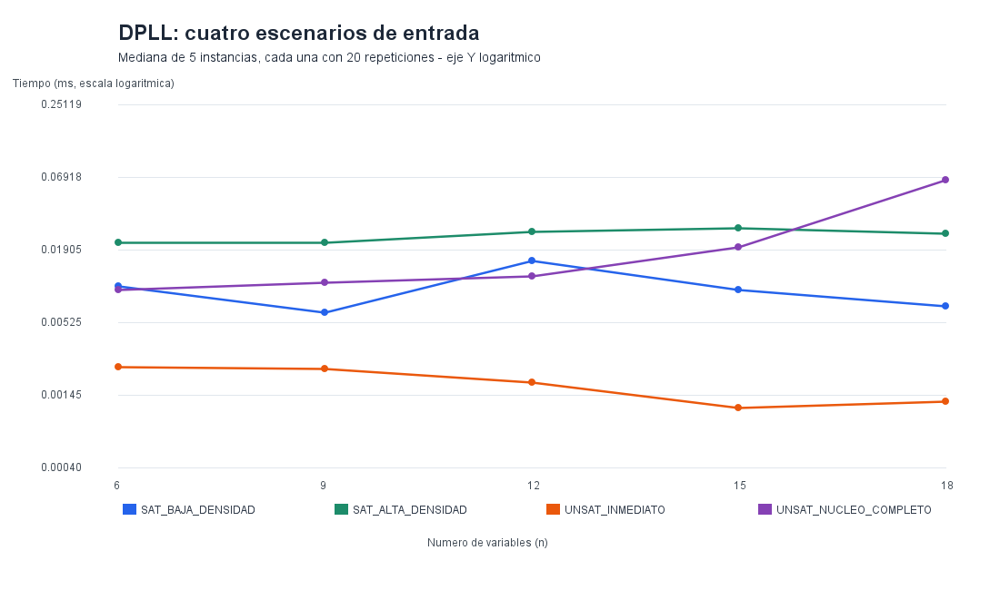
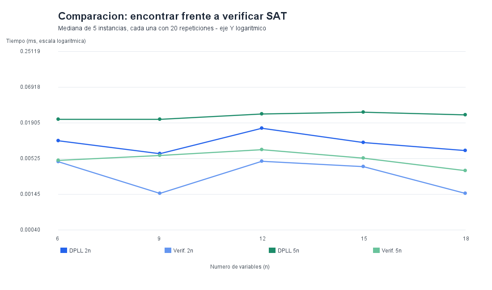

# SAT_SOLVER — Experimentación y análisis de complejidad

**Proyecto integrador:** Estructura de Datos y Algoritmos II · Unidad 2: Complejidad Computacional  
**Tema:** SAT — Sistema de validación de restricciones lógicas  
**Responsable:** Persona 5 — Complejidad y experimentación  
**Registro de las mediciones presentadas:** 8 de noviembre de 2026  
**Repositorio:** [andrea0119C/SAT_SOLVER](https://github.com/andrea0119C/SAT_SOLVER)

## 1. Objetivo y alcance

Evaluar experimentalmente una implementación **exacta de SAT mediante DPLL en Java** y comparar el costo de **encontrar** una asignación satisfactoria con el de **verificar** una asignación ya conocida. También se estudia cómo influyen el tamaño de la fórmula, la cantidad de cláusulas y la estructura de las contradicciones.

Esta carpeta reúne la metodología, el registro de resultados y las evidencias de la **primera serie (línea base)** y de la **serie ampliada**, realizadas sobre las clases Java del proyecto. Ambas series son complementarias: la primera comprueba el funcionamiento del banco de pruebas; la segunda incorpora diversidad de instancias y escenarios.

Los datos numéricos de este documento provienen de las ejecuciones compartidas por el equipo, **no son valores simulados ni cotas teóricas**. El programa SAT principal, la interfaz y el servidor no fueron modificados para obtenerlos.

### 1.1. Relación con SAT y NP

Una fórmula booleana en forma normal conjuntiva (CNF) es una conjunción de cláusulas; cada cláusula es una disyunción de literales. El problema de decisión SAT pregunta si existe una asignación de valores verdaderos o falsos que haga verdadera toda la fórmula.

SAT es **NP-completo**: una asignación satisfactoria constituye un certificado que puede comprobarse en tiempo polinomial; la dificultad general de encontrarla está relacionada con la NP-completitud demostrada por el teorema de Cook–Levin. Esto no significa que todas las instancias requieran tiempo exponencial, ni que se haya demostrado que P sea diferente de NP. En este proyecto se utiliza DPLL como procedimiento exacto para resolver SAT y un verificador independiente para comprobar asignaciones [1, 2].

## 2. Integración con el código del equipo

El benchmark invoca directamente las interfaces públicas existentes:

```java
FormulaCNF formula = /* fórmula generada fuera del cronómetro */;
Optional<Map<String, Boolean>> resultado = new DPLLSolver().solve(formula);

if (resultado.isPresent()) {
    boolean valida = new AssignmentVerifier().verify(formula, resultado.get());
}
```

| Componente | Ubicación relativa al proyecto | Función |
|---|---|---|
| `FormulaCNF` | `src/main/java/ec/edu/satsolver/model/FormulaCNF.java` | Almacena variables y cláusulas. |
| `DPLLSolver` | `src/main/java/ec/edu/satsolver/solver/DPLLSolver.java` | Ejecuta DPLL, propagación unitaria y ramificación. |
| `AssignmentVerifier` | `src/main/java/ec/edu/satsolver/verification/AssignmentVerifier.java` | Comprueba una asignación para una fórmula CNF. |
| `BenchmarkSAT` | `src/main/java/ec/edu/satsolver/experiment/BenchmarkSAT.java` | Ejecuta la línea base. |
| `BenchmarkSATAvanzado` | `src/main/java/ec/edu/satsolver/experiment/BenchmarkSATAvanzado.java` | Ejecuta los escenarios ampliados. |

**Aislamiento:** no se usa el servidor HTTP ni la interfaz gráfica para medir los algoritmos; la generación de instancias, la escritura de CSV, la producción de imágenes y las comprobaciones externas quedan fuera de los intervalos cronometrados.

## 3. Entorno de ejecución y reproducibilidad

Los metadatos de la **serie ampliada** se conservaron en `entorno.txt`:

| Parámetro | Valor registrado |
|---|---|
| Fecha | 2026-11-08 |
| Sistema operativo | Windows 11 (`os.version`: `10.0`, valor reportado por Java) |
| Java Runtime | `26.0.1+8-34` |
| Procesadores lógicos | 16 |
| Semilla base | `20261108` |
| Tamaños de entrada | `n = 6, 9, 12, 15, 18` |
| Medición temporal | `System.nanoTime()`; resultados expresados en ms |
| Medición de memoria | `BYTES_ASIGNADOS_HILO` |

Se recomienda registrar también procesador físico, memoria RAM, opciones de la JVM y *commit* de Git al realizar nuevas ejecuciones; **esos datos no figuran en el registro actual y no se inventan aquí**. Los tiempos dependen de la JVM, JIT, recolector de basura, sistema operativo y procesos en segundo plano. Los programas requieren Java 17 o posterior; los resultados documentados se obtuvieron con Java 26.

### 3.1. Comandos de ejecución

Abrir PowerShell en la **raíz interna del proyecto** `SAT_SOLVER_estructura_inicial/SAT_SOLVER`, donde está `src/`:

```powershell
New-Item -ItemType Directory -Force out-benchmark | Out-Null
$archivos = Get-ChildItem .\src\main\java -Recurse -Filter *.java | ForEach-Object { $_.FullName }
javac -encoding UTF-8 -d out-benchmark $archivos
```

Ejecutar **línea base**:

```powershell
java -cp out-benchmark ec.edu.satsolver.experiment.BenchmarkSAT
```

Ejecutar **serie ampliada**:

```powershell
java -cp out-benchmark ec.edu.satsolver.experiment.BenchmarkSATAvanzado
```

La compilación genera archivos `.class` en `out-benchmark/` y no requiere modificar los módulos Java ya existentes. Cada ejecución crea un directorio de resultados nuevo con fecha e identificador aleatorio para evitar sobrescrituras. **No es necesario ejecutar `run.bat` ni iniciar `SatHttpServer`** para estos experimentos.

## 4. Protocolo experimental

### 4.1. Serie inicial: línea base

- Tamaños: `n = {6, 9, 12, 15, 18}`.
- Dos clases por tamaño: fórmula SAT garantizada y fórmula UNSAT garantizada.
- Cantidad de cláusulas: `m = 4n`.
- Una instancia por combinación `(n, tipo)`; **10 configuraciones**.
- **12 ejecuciones de calentamiento** y **30 repeticiones cronometradas** por configuración.
- Total de **300 mediciones DPLL** y, en las cinco configuraciones SAT, **150 mediciones del verificador**.
- Resultado representativo: **mediana** de las 30 repeticiones.
- Finalidad: validar las conexiones, los resultados SAT/UNSAT, la creación de tablas y las gráficas iniciales.

Esta fase no proporciona una muestra diversa de fórmulas de igual tamaño: repetir una fórmula permite analizar la estabilidad de la medición, **no** la variabilidad entre fórmulas distintas.

### 4.2. Serie avanzada: cinco instancias por escenario

- Tamaños: `n = {6, 9, 12, 15, 18}`.
- Cuatro escenarios por tamaño: **20 configuraciones**.
- Cinco fórmulas generadas con semillas diferentes en cada configuración: **100 instancias** en total.
- **10 ejecuciones de calentamiento** y **20 repeticiones medidas** por instancia.
- Total: **2 000 mediciones DPLL** y **1 000 mediciones del verificador** para las 50 fórmulas SAT.
- Las 100 fórmulas se guardan como archivos **DIMACS CNF** en `instancias/`.
- Las semillas exactas constan en `por_instancia.csv` para posibilitar la regeneración de casos.

#### Familias de instancias

| Escenario | Construcción | Resultado esperado | Propósito |
|---|---|---|---|
| `SAT_BAJA_DENSIDAD` | Fórmula 3-CNF con `m = 2n` y asignación testigo conocida | SAT | Examinar baja densidad de restricciones. |
| `SAT_ALTA_DENSIDAD` | Fórmula 3-CNF con `m = 5n` y testigo conocido | SAT | Examinar el efecto de incrementar las cláusulas. |
| `UNSAT_INMEDIATO` | Fórmula SAT base (`2n` cláusulas) más las unitarias `(x1)` y `(!x1)` | UNSAT | Medir una contradicción directamente detectable. |
| `UNSAT_NUCLEO_COMPLETO` | Fórmula base más `2^k` cláusulas que excluyen las `2^k` asignaciones de un núcleo de `k` variables | UNSAT | Examinar contradicciones que requieren más exploración. |

Para el núcleo completo, `k = max(3, min(6, n/3))`, con división entera en Java: resulta `k = 3, 3, 4, 5, 6` para los tamaños utilizados. **Las fórmulas UNSAT no son necesariamente 3-CNF**, ya que el núcleo puede contener cláusulas de longitud `k` y la contradicción inmediata usa cláusulas unitarias. El problema implementado es SAT general.

La construcción garantiza la respuesta esperada: las fórmulas SAT se generan respetando un testigo válido; en `UNSAT_INMEDIATO` existen dos cláusulas contradictorias; y en `UNSAT_NUCLEO_COMPLETO` se excluyen todas las asignaciones del núcleo. El benchmark confirma el tipo de respuesta devuelto por DPLL y verifica los certificados SAT con `AssignmentVerifier`. Esto es control funcional para los casos ensayados, **no una prueba formal de corrección del solucionador en todas las entradas**.

### 4.3. Qué se mide y cómo se resume

El cronómetro rodea solamente las llamadas `solver.solve(formula)` y `verifier.verify(formula, asignacion)`. Para una fórmula UNSAT no se mide la verificación de una asignación satisfactoria, porque no existe dicho certificado; por eso esas celdas figuran como **N/A**.

Para la serie avanzada se emplean **dos niveles de mediana**:

1. Se calcula la mediana de las 20 repeticiones de **cada instancia**.
2. Se calcula la mediana de las cinco medianas de instancia para **cada configuración**.

Los cuartiles `Q1` y `Q3` describen las cinco medianas **entre instancias**, no la distribución de todas las repeticiones combinadas. En el código se usa el percentil por interpolación lineal sobre posiciones `0` a `N-1`; con cinco instancias, Q1 y Q3 coinciden con el segundo y cuarto valores ordenados, respectivamente.

**Memoria:** `BYTES_ASIGNADOS_HILO` utiliza `com.sun.management.ThreadMXBean` y expresa una aproximación de los **bytes de objetos asignados en el heap por el hilo durante el método** [4]. **No representa el pico de RAM, el tamaño vivo del heap ni directamente la complejidad espacial asintótica.** Si una JVM no soporta esta medida, el benchmark avanzado deja el valor vacío y lo señala en `entorno.txt`.

## 5. Resultados reales de la línea base

Los tiempos se expresan en **milisegundos**; la memoria en **bytes asignados por hilo**, según la JVM utilizada. `L` indica el número total de apariciones de literales.

| Tipo | n | m | L | DPLL (ms) | Mem. DPLL (B) | Verificador (ms) | Mem. verif. (B) |
|---|---:|---:|---:|---:|---:|---:|---:|
| SAT | 6 | 24 | 72 | 0.067300 | 1 912 | 0.034800 | 1 304 |
| UNSAT | 6 | 24 | 68 | 0.019150 | 1 448 | N/A | N/A |
| SAT | 9 | 36 | 108 | 0.023250 | 2 720 | 0.028100 | 1 904 |
| UNSAT | 9 | 36 | 104 | 0.005700 | 2 072 | N/A | N/A |
| SAT | 12 | 48 | 144 | 0.021050 | 3 408 | 0.010350 | 2 288 |
| UNSAT | 12 | 48 | 140 | 0.008200 | 2 504 | N/A | N/A |
| SAT | 15 | 60 | 180 | 0.054650 | 5 392 | 0.013850 | 2 984 |
| UNSAT | 15 | 60 | 176 | 0.020250 | 3 224 | N/A | N/A |
| SAT | 18 | 72 | 216 | 0.092800 | 6 760 | 0.012100 | 3 368 |
| UNSAT | 18 | 72 | 212 | 0.019550 | 3 656 | N/A | N/A |

**Lectura de la línea base:** para `n=18`, la mediana SAT fue `0.092800 ms` para DPLL y `0.012100 ms` para verificación (aproximadamente **7.67 veces**). Los tiempos no aumentaron monótonamente con `n`: esta primera serie demostró que el comportamiento depende también de la estructura de la entrada y del entorno de ejecución, pero no bastaba para aislar tales efectos.

**Evidencias de la línea base (copia conservada en el proyecto):**

- [CSV con las 30 repeticiones por configuración](linea_base/benchmark_20261108_164129_c9042c23/resultados.csv)
- [CSV resumen](linea_base/benchmark_20261108_164129_c9042c23/resumen.csv)
- [Gráfica: tiempo de DPLL](linea_base/benchmark_20261108_164129_c9042c23/grafico_tiempos.png)
- [Gráfica: DPLL frente a verificación](linea_base/benchmark_20261108_164129_c9042c23/grafico_comparacion.png)

Se conserva además la ejecución original en `../experiment/resultados/benchmark_20261108_164129_c9042c23/`; la copia `linea_base/` es una copia de seguridad, no un experimento adicional.

## 6. Resultados reales de la serie avanzada

Cada fila presenta la **mediana de cinco medianas por instancia**, salvo las columnas `Q1` y `Q3` (cuartiles entre instancias). Los valores `N/A` indican que no corresponde verificar un certificado SAT para fórmulas UNSAT.

| Escenario | n | DPLL (ms) | Q1 (ms) | Q3 (ms) | Mem. DPLL (B) | Verif. (ms) | Mem. verif. (B) |
|---|---:|---:|---:|---:|---:|---:|---:|
| `SAT_BAJA_DENSIDAD` | 6 | 0.010000 | 0.009950 | 0.019000 | 1 352 | 0.004700 | 664 |
| `SAT_ALTA_DENSIDAD` | 6 | 0.021650 | 0.018950 | 0.023600 | 2 680 | 0.004900 | 1 496 |
| `UNSAT_INMEDIATO` | 6 | 0.002400 | 0.002400 | 0.002400 | 728 | N/A | N/A |
| `UNSAT_NUCLEO_COMPLETO` | 6 | 0.009450 | 0.008400 | 0.009950 | 1 464 | N/A | N/A |
| `SAT_BAJA_DENSIDAD` | 9 | 0.006300 | 0.005600 | 0.006650 | 2 040 | 0.001500 | 904 |
| `SAT_ALTA_DENSIDAD` | 9 | 0.021750 | 0.021000 | 0.022350 | 3 128 | 0.005900 | 2 136 |
| `UNSAT_INMEDIATO` | 9 | 0.002300 | 0.002250 | 0.002400 | 976 | N/A | N/A |
| `UNSAT_NUCLEO_COMPLETO` | 9 | 0.010750 | 0.010700 | 0.011700 | 1 864 | N/A | N/A |
| `SAT_BAJA_DENSIDAD` | 12 | 0.015800 | 0.015000 | 0.015850 | 2 752 | 0.004800 | 1 248 |
| `SAT_ALTA_DENSIDAD` | 12 | 0.026200 | 0.016500 | 0.026650 | 5 496 | 0.007200 | 2 928 |
| `UNSAT_INMEDIATO` | 12 | 0.001800 | 0.001800 | 0.001800 | 1 336 | N/A | N/A |
| `UNSAT_NUCLEO_COMPLETO` | 12 | 0.011900 | 0.010500 | 0.012900 | 3 472 | N/A | N/A |
| `SAT_BAJA_DENSIDAD` | 15 | 0.009350 | 0.008300 | 0.010650 | 3 384 | 0.003950 | 1 440 |
| `SAT_ALTA_DENSIDAD` | 15 | 0.028150 | 0.027500 | 0.037550 | 6 560 | 0.005350 | 3 864 |
| `UNSAT_INMEDIATO` | 15 | 0.001150 | 0.001100 | 0.001400 | 1 536 | N/A | N/A |
| `UNSAT_NUCLEO_COMPLETO` | 15 | 0.020000 | 0.019500 | 0.020700 | 6 304 | N/A | N/A |
| `SAT_BAJA_DENSIDAD` | 18 | 0.007000 | 0.006900 | 0.008400 | 4 280 | 0.001500 | 1 760 |
| `SAT_ALTA_DENSIDAD` | 18 | 0.025600 | 0.017750 | 0.027700 | 7 768 | 0.003400 | 4 256 |
| `UNSAT_INMEDIATO` | 18 | 0.001300 | 0.001300 | 0.001700 | 1 960 | N/A | N/A |
| `UNSAT_NUCLEO_COMPLETO` | 18 | 0.066200 | 0.058900 | 0.069050 | 12 376 | N/A | N/A |

### 6.1. Gráfica 1 — Tiempo de DPLL por escenario



**Interpretación:** `UNSAT_INMEDIATO` registró tiempos bajos en todos los tamaños debido a la contradicción unitaria explícita. `UNSAT_NUCLEO_COMPLETO` pasó de `0.009450 ms` con seis variables a `0.066200 ms` con dieciocho; parte de esta variación se relaciona con el aumento del núcleo `k`, no solo con `n`. Las curvas SAT no son monótonas, lo que impide concluir una ley de crecimiento a partir de estos cinco tamaños.

### 6.2. Gráfica 2 — Encontrar frente a verificar una solución SAT



**Interpretación:** para `n=18`, con baja densidad, DPLL registró `0.007000 ms` frente a `0.001500 ms` del verificador (**4.67 veces**); con alta densidad, `0.025600 ms` frente a `0.003400 ms` (**7.53 veces**). Son diferencias observadas en estas familias de fórmulas y no una desigualdad universal entre ambos métodos.

**Nota sobre las imágenes:** ambas usan un **eje vertical logarítmico** para mostrar tiempos pequeños y de diferentes órdenes de magnitud. No se debe leer una separación vertical uniforme como una diferencia absoluta uniforme de milisegundos.

### 6.3. Tres hallazgos cuantitativos

1. **Densidad SAT (`n=18`):** `SAT_ALTA_DENSIDAD` (`m=90`) tuvo una mediana de `0.025600 ms`, frente a `0.007000 ms` de `SAT_BAJA_DENSIDAD` (`m=36`): aproximadamente **3.66 veces** más. Más cláusulas significaron más trabajo en estas instancias; en otros conjuntos podrían facilitar la poda.
2. **Tipo de contradicción (`n=18`):** `UNSAT_NUCLEO_COMPLETO` registró `0.066200 ms` frente a `0.001300 ms` de `UNSAT_INMEDIATO`: aproximadamente **50.92 veces**. Esta diferencia contrasta propagación inmediata con exploración más amplia; el núcleo solo abarca **seis variables**.
3. **Memoria asignada (`n=18`):** DPLL asignó una mediana de **12 376 B** en `UNSAT_NUCLEO_COMPLETO`, **7 768 B** en `SAT_ALTA_DENSIDAD` y **1 960 B** en `UNSAT_INMEDIATO`. Son datos de **asignación por hilo**, no de memoria ocupada simultáneamente.

### 6.4. Archivos y trazabilidad

La ejecución compartida está guardada bajo:

```text
experiments/
├── README.md
├── linea_base/
│   └── benchmark_20261108_164129_c9042c23/
│       ├── resultados.csv
│       ├── resumen.csv
│       ├── entorno.txt
│       ├── grafico_tiempos.png
│       └── grafico_comparacion.png
└── resultados/
    └── ampliado_20261108_165829_e319bfd7/
        ├── mediciones.csv                  # 2 000 filas de medición
        ├── por_instancia.csv               # 100 resúmenes individuales
        ├── resumen.csv                     # 20 configuraciones
        ├── entorno.txt
        ├── grafico_dpll_escenarios.png
        ├── grafico_resolver_verificar.png
        └── instancias/                    # 100 fórmulas DIMACS .cnf
```

Accesos directos: [mediciones individuales](resultados/ampliado_20261108_165829_e319bfd7/mediciones.csv) · [medianas por fórmula](resultados/ampliado_20261108_165829_e319bfd7/por_instancia.csv) · [resumen por configuración](resultados/ampliado_20261108_165829_e319bfd7/resumen.csv) · [metadatos del entorno](resultados/ampliado_20261108_165829_e319bfd7/entorno.txt).

Los vínculos relativos funcionarán en GitHub **si se incorporan esas carpetas con los mismos nombres**. El informe consolidado debe citar esta ejecución y conservar su fecha; una nueva corrida producirá otros resultados y otra ruta.

## 7. Análisis teórico de complejidad: O, Ω y Θ

Definimos:

- `n`: cantidad de variables booleanas;
- `m`: cantidad de cláusulas;
- `L`: número total de apariciones de literales (`L = Σ |C_i|`).

Estas magnitudes son relevantes porque el costo de inspeccionar una CNF depende del **tamaño de su representación**, no exclusivamente de `n`.

### 7.1. DPLL: búsqueda exacta

El DPLL implementado recorre cláusulas, aplica propagación unitaria, comprueba contradicciones y elige una variable libre para ramificar recursivamente con los valores verdadero y falso. La profundidad de ramificación no supera `n`; un árbol binario de decisiones puede tener `O(2^n)` nodos. En un nodo, la propagación puede realizar hasta `O(n)` pasadas sobre una representación de longitud `L`, además de gestionar copias de asignaciones de tamaño `O(n)`.

Una **cota superior conservadora** para esta implementación es:

```text
T_DPLL(n, L) ∈ O(2^n · n · (L + n))
S_aux_DPLL(n, L) ∈ O(L + n²)
```

La cota espacial considera la copia de las cláusulas obtenida de `FormulaCNF.clauses()`, hasta `n` niveles de llamadas recursivas y copias de arreglos de asignación. No suma nuevamente la memoria de la fórmula de entrada como si fuera auxiliar.

- **Mejor caso:** una fórmula puede resolverse tras una sola pasada sin ramificar, con tiempo `Θ(n + L)` para esa familia de entradas en esta implementación; la propia copia defensiva de cláusulas y la inicialización del arreglo justifican un costo mínimo `Ω(n + L)`.
- **Peor caso:** la ramificación de DPLL puede generar exploración exponencial. La expresión anterior da una **cota O** de la implementación; **no se afirma `Θ(2^n)` para todas las instancias ni se ha demostrado una cota ajustada de peor caso para este código**.
- **Caso promedio:** no se establece una fórmula asintótica `Θ` porque requeriría una distribución probabilística precisa de instancias y un análisis de su ejecución bajo esa distribución. Las familias generadas aquí no constituyen tal demostración.

### 7.2. Verificador: comprobación de un certificado

El verificador recibe una fórmula y un mapa con una asignación completa. Comprueba la presencia de todas las variables y evalúa las cláusulas hasta encontrar un literal verdadero por cláusula, o una cláusula falsa. El código actual llama a `FormulaCNF.clauses()`, método que **copia todas las cláusulas** antes de recorrerlas.

Bajo el modelo habitual de acceso promedio `O(1)` a un mapa hash:

```text
T_verificador(n, L) ∈ Θ(n + L)  [implementación actual]
S_aux_verificador(n, L) ∈ O(L)
```

La cota temporal ajustada se refiere a entradas y asignaciones válidas y considera la copia completa de cláusulas, incluso si la comprobación lógica pudiera detenerse antes. El espacio auxiliar corresponde a esa copia, no al mapa de asignación suministrado como entrada. Cambiar las estructuras internas podría modificar estos costos, pero **no se propone alterar aquí el código de los demás integrantes**.

### 7.3. Diferencia conceptual entre búsqueda y verificación

- `O(g)` designa una **cota superior** asintótica; `Ω(g)`, una **cota inferior**; y `Θ(g)`, una **cota ajustada**.
- Verificar una asignación satisfactoria es polinomial en el tamaño de la fórmula, característica fundamental de SAT como problema en **NP**.
- DPLL es exacto y puede necesitar explorar alternativas exponenciales en el peor caso, aunque muchos casos concretos son fáciles.
- **Ninguna gráfica de cinco tamaños demuestra por sí misma una notación asintótica**. Los experimentos contrastan tendencias con la teoría, no reemplazan las demostraciones matemáticas.

## 8. Discusión de resultados y limitaciones

**¿Qué determina el tiempo?** Además de `n` y `L`, influyen la densidad `m/n`, los signos de los literales, el orden de cláusulas, la propagación unitaria, la posición de las contradicciones y el orden de ramificación. Por eso los tiempos SAT no fueron estrictamente crecientes con `n`.

**¿Qué diferencia existe entre SAT y UNSAT?** No existe una regla según la cual UNSAT sea siempre más difícil o más fácil. En nuestros datos, la contradicción unitaria fue rápida, mientras que el núcleo completo requirió más tiempo; ambas instancias son UNSAT por construcción.

**¿Coincide la teoría con las mediciones?** La teoría admite exploración exponencial de DPLL y verificación polinomial. Los datos muestran diferencias entre búsqueda y verificación, pero **no permiten estimar ni confirmar la base de un crecimiento exponencial general**: la muestra es pequeña y las familias son artificiales.

**Limitaciones y posibles sesgos:**

1. **Escala temporal muy corta:** las duraciones están en microsegundos (aunque se expresan en ms), por lo que JIT, GC, cachés, CPU y procesos en segundo plano pueden alterar diferencias pequeñas.
2. **Cinco instancias por grupo:** son útiles para una comparación exploratoria, pero insuficientes para generalizar a todas las fórmulas SAT de ese tamaño.
3. **Testigo plantado en SAT:** asegura satisfacibilidad, pero introduce sesgo de construcción; no representa una distribución uniforme de fórmulas SAT.
4. **UNSAT controlado:** el núcleo completo excluye todas las asignaciones de `k ≤ 6` variables, incluso cuando `n=18`; por ello **no es un experimento de peor caso respecto de todas las variables**.
5. **Variables de diseño relacionadas:** al aumentar `n`, también crece `m`; y en el núcleo completo varía `k`, por lo que no es posible atribuir todos los efectos únicamente a `n`.
6. **Memoria registrada:** los bytes asignados por hilo no describen la memoria máxima retenida; las comparaciones de memoria deben hacerse con esta advertencia.
7. **Ausencia de prueba UNSAT independiente para todas las entradas:** la insatisfacibilidad está garantizada por construcción, y el solucionador se comprueba frente a la respuesta esperada; el benchmark no ofrece un certificado externo general de UNSAT.
8. **Reproducibilidad del entorno:** hay semilla y archivos DIMACS, pero no quedó registrado el hash exacto del *commit*, el procesador físico ni la configuración completa de la máquina.

**Mejoras futuras:** variar `m` manteniendo `n` fijo; aumentar los tamaños y la diversidad de instancias sin exceder tiempos razonables; comparar cantidad de nodos/decisiones de DPLL además de tiempo; añadir pruebas de verificación independientes y emplear herramientas de microbenchmarking para valores muy pequeños. Estas mejoras **no son condiciones que se hayan realizado en la serie actual**.

## 9. Conclusiones

1. **El banco de pruebas funciona de forma independiente.** Las dos clases experimentales ejecutan el DPLL y el verificador del equipo sin modificar el algoritmo, el parser, el servidor o la interfaz.
2. **La dificultad depende de la estructura.** La diferencia de aproximadamente **50.92×** entre el núcleo completo y la contradicción inmediata a `n=18` ilustra que el número de variables, por sí solo, no caracteriza el costo de DPLL.
3. **Buscar y verificar cumplen funciones diferentes.** En las fórmulas SAT de 18 variables, DPLL tomó **4.67×** y **7.53×** el tiempo de verificación en los escenarios de baja y alta densidad, respectivamente; son resultados de las familias evaluadas.
4. **La diversidad mejora la evidencia, pero no sustituye la teoría.** Pasar de una instancia por configuración a cinco instancias y cuatro escenarios permite una discusión más sólida, sin que ello demuestre experimentalmente cotas asintóticas generales.
5. **La reproducibilidad es verificable.** Las semillas, mediciones individuales, estadísticas, gráficas, metadatos y archivos DIMACS permiten revisar los resultados y repetir el procedimiento; deben conservarse junto con el informe técnico.

## 10. Correspondencia con los requisitos del docente

| Requisito | Evidencia disponible |
|---|---|
| Al menos cinco tamaños | `n = 6, 9, 12, 15, 18` en ambas series. |
| Repetición de medidas | 30 por configuración inicial; 20 por instancia ampliada. |
| Tiempo y memoria | CSV individual, resúmenes; método de memoria explicado. |
| Dos gráficas | `grafico_dpll_escenarios.png` y `grafico_resolver_verificar.png`. |
| Comparación encontrar/verificar | Las dos familias SAT se miden con ambas operaciones. |
| O, Ω y Θ | Sección 7 con hipótesis y cotas justificadas. |
| Discusión y limitaciones | Secciones 8 y 9. |
| Datos para el informe PDF | Tablas reales, imágenes y registros de entorno. |

La reflexión grupal de NotebookLM, capturas y fundamentación adicional corresponden al **informe consolidado del equipo** y no se presentan aquí como completadas.

## 11. Referencias

1. **Davis, M., Logemann, G. y Loveland, D. W.** (1962). *A machine program for theorem-proving*. *Communications of the ACM*, 5(7), 394–397. https://doi.org/10.1145/368273.368557
2. **Cook, S. A.** (1971). *The complexity of theorem-proving procedures*. *Proceedings of the Third Annual ACM Symposium on Theory of Computing*, 151–158. https://doi.org/10.1145/800157.805047
3. **Oracle.** Java SE 17 — `System.nanoTime()`. https://docs.oracle.com/en/java/javase/17/docs/api/java.base/java/lang/System.html#nanoTime()
4. **Oracle.** Java SE 17 — `com.sun.management.ThreadMXBean`, `getThreadAllocatedBytes`. https://docs.oracle.com/en/java/javase/17/docs/api/jdk.management/com/sun/management/ThreadMXBean.html
5. **Equipo SAT_SOLVER.** Código Java y resultados experimentales del presente repositorio: `DPLLSolver.java`, `AssignmentVerifier.java`, `FormulaCNF.java`, `BenchmarkSAT.java`, `BenchmarkSATAvanzado.java` y archivos CSV/DIMACS enlazados en este documento (2026).

---

**Nota de conservación:** no sobrescribir ni eliminar las carpetas de resultados originales. La documentación se basa en las ejecuciones identificadas en las rutas anteriores. Para publicar esta evidencia en GitHub, revisar `git status` y el archivo `.gitignore`; excluir `out-benchmark/` y otros artefactos compilados y versionar solo código fuente, documentación y resultados seleccionados para la entrega.
